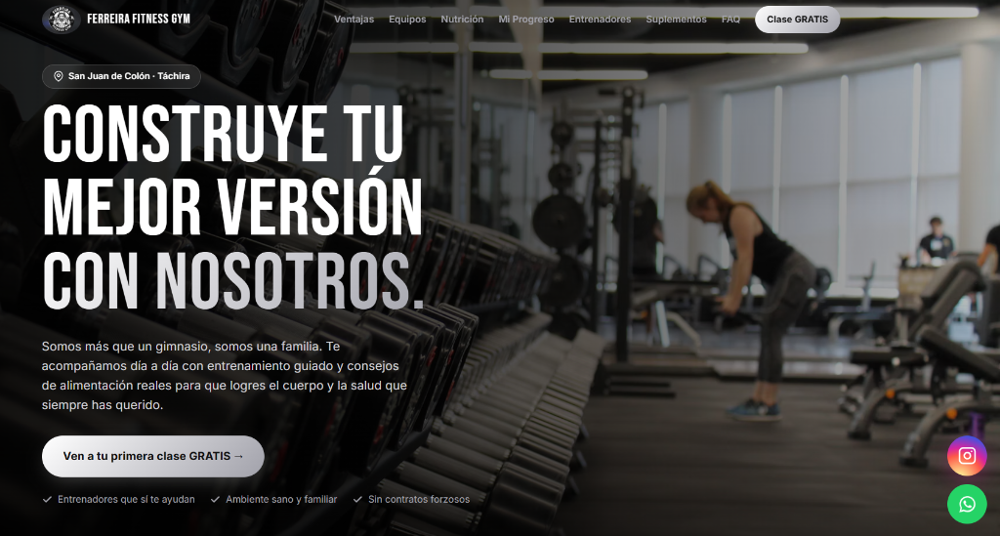
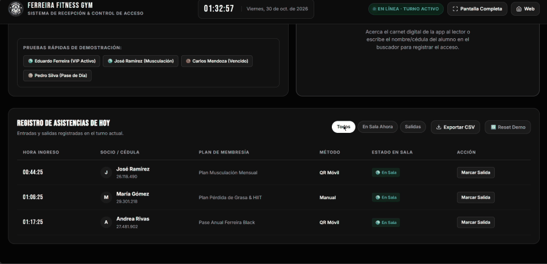
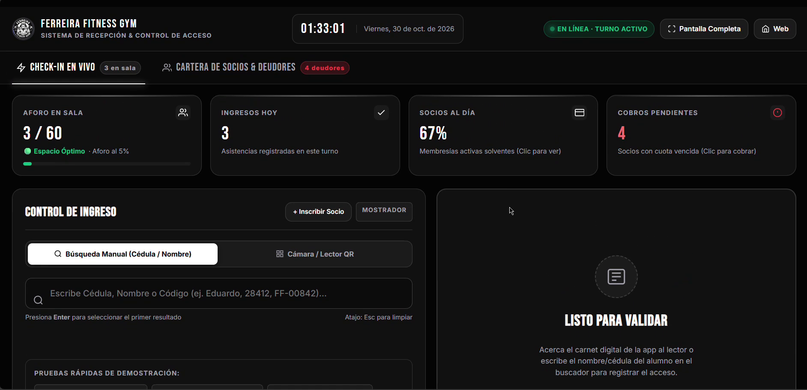
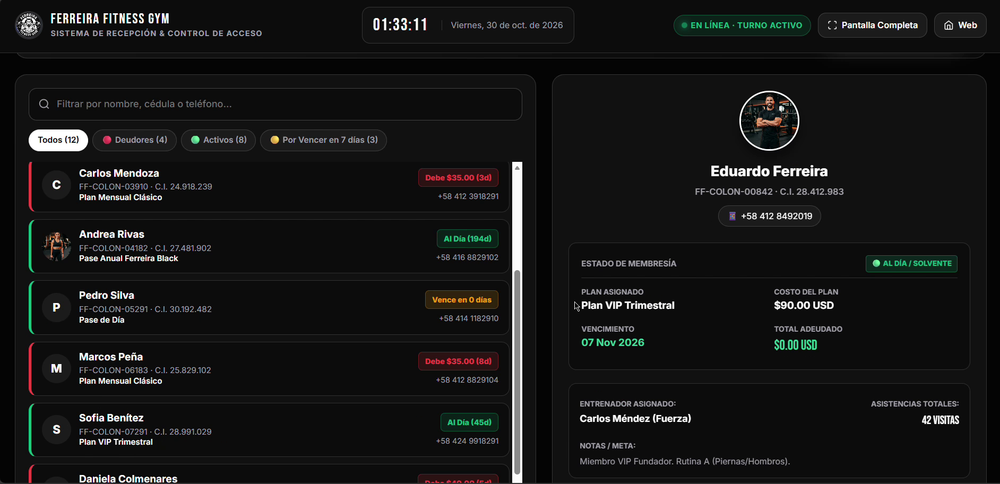
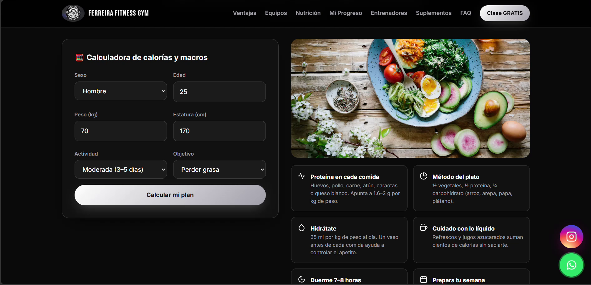
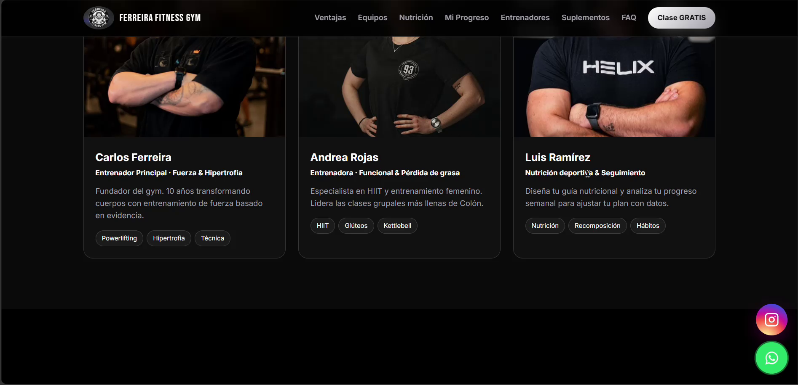

<div align="center">
  
</div>

<h1 align="center">Ferreira Fitness GYM</h1>
<p align="center">
  Plataforma web comercial y sistema de control de acceso en recepción sincronizado en tiempo real.
</p>

<p align="center">
  
  
  
  
  
</p>

---

## Descripcion General

Sistema web diseñado para **Ferreira Fitness GYM** (San Juan de Colón, Táchira), dividido en dos entornos operativos complementarios:

1. **Portal Comercial de Captación (`index.html`):** Interfaz pública optimizada para conversión de prospectos, consulta de servicios, calculadora nutricional y agendamiento directo.
2. **Sistema Operativo de Recepción (`recepcion.html`):** Panel administrativo para el mostrador del gimnasio que gestiona control de ingreso de socios, lectura de credenciales QR, monitoreo de aforo en sala y auditoría de cuotas vencidas en tiempo real.

---

## Demostracion del Sistema de Recepcion

<div align="center">
  
</div>

---

## Modulos del Sistema

### 1. Control de Acceso y Mostrador

La interfaz de recepción centraliza el flujo diario del gimnasio mediante validación instantánea y métricas en vivo conectadas a la base de datos.

<div align="center">
  
</div>

* **Validacion Dual de Ingreso:** Admite escaneo por cámara de carnet digital QR y búsqueda asistida por cédula o nombre con atajos de teclado.
* **Control de Aforo Activo:** Cálculo automático de ocupación en sala con semáforo de capacidad máxima y conteo de ingresos por turno.
* **Filtros de Asistencia Diaria:** Segmentación rápida entre socios actualmente en sala, total de ingresos del día y salidas registradas.

<br />

### 2. Cartera de Socios y Auditoria de Pagos

Módulo orientado a la administración de membresías activas, vencimientos y cobranzas en mostrador.

<div align="center">
  
</div>

* **Balance Financiero Inmediato:** Totalización de ingresos por cobrar y conteo de cuentas vencidas en dólares estadounidenses (USD).
* **Ficha Detallada del Alumno:** Consulta de plan contratado (Mensual, Trimestral, Anual), fecha de caducidad, saldo pendiente, entrenador asignado y total de visitas históricas.
* **Acciones Rapidas:** Registro de pago directo en recepción, renovación de plan, marcaje manual y gestión de baja de usuario.

---

### 3. Portal Comercial e Interaccion

La landing page comercial proporciona herramientas interactivas orientadas a fidelizar al usuario antes de formalizar su inscripción.

<div align="center">
  
  
</div>

* **Calculadora de Calorías y Macronutrientes:** Formulario dinámico que procesa sexo, edad, peso, estatura, nivel de actividad y objetivo (perder grasa, mantenimiento o volumen) para proyectar requerimientos calóricos diarios y distribución de macronutrientes.
* **Directorio de Entrenadores:** Perfiles técnicos del staff con especialidades certificadas (Powerlifting, Hipertrofia, Funcional, Recomposición).
* **Canales de Atencion:** Botones directos de contacto con WhatsApp e Instagram institucional y reserva de primera sesión gratuita.

---

## Arquitectura y Persistencia de Datos

El sistema implementa una arquitectura orientada a eventos con persistencia centralizada en **Supabase (PostgreSQL)**:

```
[ Cliente Web / Recepcion ]  <--- WebSocket (Realtime Channel) --->  [ Supabase Engine ]
[ App Movil / Socios QR    ]  --->  HTTPS / PostgREST REST API  --->  [ PostgreSQL DB ]
```

* **Suscripcion en Tiempo Real:** La recepción escucha eventos `INSERT` y `UPDATE` sobre la tabla de asistencias, actualizando el tablero al instante cuando un entrenador o socio registra una interacción.
* **Seguridad en Tablas (RLS):** Se aplican directivas de **Row Level Security** en PostgreSQL para segregar permisos de consulta pública frente a modificaciones restringidas de cuotas y registros de asistencia.
* **Scripts SQL Incluidos:** La carpeta `supabase/` contiene los scripts de estructura relacional (`create_routines_table.sql`) y políticas de acceso (`fix_delete_policies.sql`).

---

## Estructura del Repositorio

```text
├── assets/
│   ├── img/                 # Recursos gráficos y fotografías del gimnasio
│   └── screenshots/         # Capturas de pantalla e interfaces del sistema
├── css/
│   ├── styles.css           # Estilos de la landing page comercial
│   └── recepcion.css        # Hoja de estilos del panel de recepción
├── js/
│   ├── config.js            # Inicialización del cliente Supabase
│   ├── main.js              # Lógica interactiva de la landing comercial
│   ├── recepcion.js         # Lógica operativa y suscripciones en tiempo real
│   └── tracker.js           # Métricas de navegación interna
├── supabase/
│   ├── create_routines_table.sql   # Esquema de tablas y políticas RLS
│   └── fix_delete_policies.sql     # Corrección de permisos en base de datos
├── index.html               # Página web comercial
└── recepcion.html           # Panel de control de acceso
```

---

## Instalacion y Ejecucion Local

1. **Clonar el repositorio:**
   ```bash
   git clone https://github.com/ejcb11/landing-page-GYM.git
   cd landing-page-GYM
   ```

2. **Configurar variables de conexion:**
   Edite el archivo `js/config.js` e introduzca las credenciales de su proyecto en Supabase:
   ```javascript
   const SUPABASE_URL = "https://tu-proyecto.supabase.co";
   const SUPABASE_ANON_KEY = "tu-anon-key";
   ```

3. **Ejecutar servidor local:**
   Puede abrir directamente los archivos con cualquier servidor HTTP local:
   ```bash
   # Utilizando Python
   python -m http.server 8000

   # O con extension Live Server en VS Code
   ```
   Acceda a `http://localhost:8000/index.html` para el portal comercial o `http://localhost:8000/recepcion.html` para el panel de recepción.

---

## Autor

**Eduardo José Contreras Borrero**  
Software Developer & Full Stack Junior  
* **LinkedIn:** [linkedin.com/in/eduardo-contreras-dev](https://www.linkedin.com/in/eduardo-contreras-dev/)  
* **GitHub:** [@ejcb11](https://github.com/ejcb11)  
* **Contacto:** ejcb2006@gmail.com
